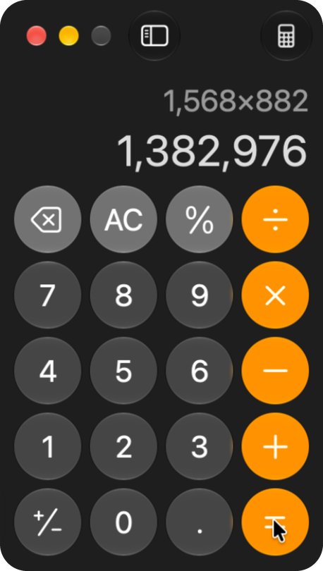
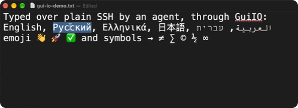

# GuiIO

GuiIO turns a Mac's screen into a file. Reading the file captures the screen, and writing to a
second file moves the mouse and presses keys. Any process on the Mac can use them, including an
AI agent logged in over plain SSH.

```sh
$ ssh mac gui click 545 636                          # click, wait for the screen to settle
/Users/you/.local/state/gui-io/screen.jpg
$ ssh mac cat .local/state/gui-io/screen.jpg > now.jpg   # the screen as it is at this moment
```

<p align="center">
  
</p>

An agent on SSH worked out 1568 × 882 (the size of `screen.jpg` itself) by clicking Calculator's
buttons at coordinates it read off `screen.jpg`. The image above is `zoom.png` of the window. See
[Examples](#examples).

## Why

macOS gates screen capture behind **Screen Recording** and synthetic mouse and keyboard events
behind **Accessibility**. TCC grants both to a process's *responsible app*. In a terminal window
that is the terminal app. Over SSH it is `sshd-keygen-wrapper`, which has neither grant and is
never asked for one. So an agent or script on SSH can't see the screen or click anything.

GuiIO.app holds both grants itself and runs as a LaunchAgent in the logged-in user's session.
It serves the screen and takes input through files in `~/.local/state/gui-io/`. Whatever reads
and writes those files needs no grant of its own: `cat`, a shell script, or an agent's ordinary
file-reading tool all work. GuiIO doesn't depend on a terminal app, tmux or an SSH session. It
starts at login and keeps running.

## How it works

```
 any process (SSH included)                          GuiIO.app  (LaunchAgent, holds both grants)
 ─────────────────────────                           ──────────────────────────────────────────
 read  screen.jpg  ◀──── JPEG of the screen now ──── ScreenCaptureKit, scaled on the GPU
 read  screen.json ◀──── size, scale, cursor ─────── written just before each image
 write in          ───── "click 545 636" ──────────▶ CGEvent: mouse, keyboard, scroll
 read  out         ◀──── "42 ok display=1 ms=12" ─── one ack per command
 read  zoom.png    ◀──── full-resolution crop ────── "zoom X Y W H"
```

- **`screen.jpg` is a named pipe.** Opening it captures display 1, the one with the menu bar,
  at that moment. The reader gets one JPEG, 1568 px on the long edge (1568 × 882 for a 16:9
  display), and then end of file. 1568 px is the largest image Claude's vision takes without
  scaling it down. `screen-2.jpg` is the second display, and so on.
- **`in` is a FIFO** that takes one command per line, optionally starting with an id.
  Coordinates are in `screen.jpg`'s pixels, so an agent clicks at the spot it sees in the image.
- **`out`** gets one ack line per command: `<id> ok display=1 [path=…] ms=T` or
  `<id> err <why>`.
- **`gui`** is a small zsh client that does the FIFO round trip for you. After every input
  command it waits for the screen to stop changing, then prints the path to read next.

**Nothing is captured until someone asks.** An idle GuiIO runs no capture stream, writes nothing
and uses no CPU, with a footprint of about 10 MB. The first read or command starts a
ScreenCaptureKit stream for each display (a cold read took about 170 ms in testing). The stream
only delivers frames when the screen changes, and a frame is encoded only when `screen.jpg` is
read. Warm reads take 15–35 ms. After 60 s with no read or command, the streams stop again.

**Each reader gets its own pipe.** As soon as a reader opens `screen.jpg`, a new FIFO takes that
name, and the first reader is served on a thread of its own. A slow reader therefore gets one
whole image and end of file, and a reader that stalls holds up nobody. (Two readers that open the
pipe in the very same instant still share it, and split one image between them.)

**Every read and command wakes the display.** While a display wakes up it sends black frames
for a second or two. GuiIO drops those and waits, up to 8 s, for the first real frame.

**`settle`** waits until no frame has changed more than 0.3% of the screen for 250 ms (at most
3 s). The change is measured on the luma of every 8th pixel. A blinking caret, a spinner, a
clock or the moving cursor doesn't hold it up, but a window, a menu or a page appearing does.
`gui` sends `settle` after each input command, so the next read shows the result.

## Requirements

- macOS 14 or later, in a logged-in user session (a LaunchAgent runs in the user's GUI session,
  so no one logged in means no screen). Tested on Apple silicon, with macOS 27.
- The Xcode Command Line Tools (`xcode-select --install`), for `swiftc`. Xcode itself, if
  installed, also compiles the app icon (see Files).
- A code-signing identity. TCC ties both grants to the bundle id *and* the signing certificate,
  so every build has to be signed with the same one. An "Apple Development" certificate works,
  and a free Apple ID gets one in Xcode (Settings → Accounts → Manage Certificates → +). If you
  sign ad hoc (`GUI_IO_SIGN=-`), the grants have to be given again after every rebuild.

## Install

```sh
git clone https://github.com/stepankandrushin/gui-io.git
cd gui-io
zsh build.sh
```

`build.sh` compiles the single Swift file, signs the app and installs three things:

- `~/Applications/GuiIO.app`
- `~/Library/LaunchAgents/<bundle id>.plist`
- the client as `~/.local/bin/gui`

It then loads or restarts the LaunchAgent, and the log goes to `~/Library/Logs/gui-io.log`. The
new bundle replaces the old one by rename, because overwriting the running binary would kill it
with "Code Signature Invalid".

| variable | default |
| --- | --- |
| `GUI_IO_SIGN` | the first "Apple Development" identity in `security find-identity -v -p codesigning`; `-` signs ad hoc |
| `GUI_IO_ID` | the bundle id of the GuiIO.app already installed, else `io.github.stepankandrushin.gui-io` (Info.plist). Pick your own on the first install, e.g. `GUI_IO_ID=com.example.gui-io` |

Over SSH the login keychain is locked, and codesign needs it. Unlock it in the same connection
first:

```sh
ssh -t mac 'security unlock-keychain ~/Library/Keychains/login.keychain-db && cd gui-io && zsh build.sh'
```

### The two grants

The first start asks for Screen Recording. Someone at the Mac, or on Screen Sharing, has to click
through these once:

1. "GuiIO.app would like to record this computer's screen and audio": click **Open System
   Settings** and switch GuiIO.app on. Then choose **Later** at "Quit & Reopen". GuiIO notices
   the grant and starts capturing within 2 s.
2. "GuiIO is requesting to bypass the system private window picker…": click **Allow**. macOS
   asks this again every 30 days.
3. System Settings → Privacy & Security → Accessibility: switch GuiIO.app on.

`gui status` should now show `screen=granted accessibility=granted`. Rebuilds keep both grants.
Without Accessibility, input commands answer `err Accessibility is not granted…`. Without Screen
Recording, every command except `status` answers `err no screen capture: …`.

## Usage

### The `gui` client

```sh
gui shot                      # wake the display, print screen.jpg's path
gui click 812 440             # click, wait for the screen to settle, print screen.jpg's path
gui click 812 440 right       # right click; "left 2" is a double click
gui drag 195 96 219 96        # press, move in steps, release: select a word
gui type 'Привет 👋'           # any Unicode, whatever the input source; a newline presses return
gui key cmd+s                 # shortcuts: cmd+shift+4, return, esc, tab, f5, cmd+a delete
gui scroll 0 10 400 220       # 10 lines down, with the pointer at 400 220
gui zoom 190 78 420 45        # full-resolution crop, prints zoom.png's path
gui -n key esc                # don't wait for the screen to settle: print the ack instead
gui status                    # grants, capture state, displays, version
gui raw 'click 10 10'         # send one command line as it is
```

`gui` exits with 1 for an `err` ack, 2 when no ack arrives within `GUI_TIMEOUT` seconds
(default 10), and 3 when GuiIO isn't running. `GUI_VERBOSE=1` prints every ack, with GuiIO's
own time (`ms=`) and the round trip. That's how to measure latency:

```
$ GUI_VERBOSE=1 gui click 400 200
gui: g4211r1093.1 ok display=1 ms=25 (36 ms)
gui: g4211r1093.2 ok display=1 path=/Users/you/.local/state/gui-io/screen.jpg ms=254 (281 ms)
/Users/you/.local/state/gui-io/screen.jpg
```

The first ack is the click, sent once its events were posted. The second is the `settle` that
`gui` added.

### Reading the screen

```sh
cat ~/.local/state/gui-io/screen.jpg > s.jpg    # an agent simply reads the path
cat ~/.local/state/gui-io/screen.json
```

```json
{"seq":1000,"time":1793813699.271,"width":1568,"height":882,"display":1,"displays":1,
 "display_id":2,"image":"/Users/you/.local/state/gui-io/screen.jpg","origin":[0,0],
 "scale":1.6326530612244898,"pixel_scale":2.0,"cursor":[308,108]}
```

`screen.json` describes the image last read from `screen.jpg`, and is written just before that
image goes into the pipe. Its fields:

- `seq`: the image's sequence number.
- `time`: when the frame was captured, in Unix seconds.
- `origin` and `scale`: global points = `origin` + pixel × `scale`.
- `pixel_scale`: backing pixels per point.
- `cursor`: the pointer in `screen.jpg` pixels, `null` when it's on another display.

A pipe has no size and can't seek. That means `scp` (its SFTP mode refuses "not a regular
file"), Preview and Quick Look can't open it. Use `cat` to copy it into a regular file first. A
read while GuiIO isn't running waits for it, rather than failing.

### From another machine

```sh
ssh mac gui click 812 440
ssh mac cat .local/state/gui-io/screen.jpg > screen.jpg   # not scp: it is a pipe
```

### Without the client

```sh
echo '42 key cmd+s' > ~/.local/state/gui-io/in      # "42" is an optional id
tail -n 1 ~/.local/state/gui-io/out                 # 42 ok display=1 ms=14
```

Keep each line under 512 bytes, so that one `write()` stays atomic when several writers share the
FIFO (`gui` splits long text itself). `out` is truncated once it passes 1 MB. If a reader finds
it shorter than its saved offset, it should read again from 0.

### Telling an agent about it

A paragraph like this one in the agent's instructions (`AGENTS.md`, `CLAUDE.md`) is enough:

```markdown
## The screen
This Mac's screen is ~/.local/state/gui-io/screen.jpg: read it to see the screen as it is now
(1568 px wide). Act with `gui` in that image's pixels: `gui click X Y`, `gui type TEXT`,
`gui key cmd+s`, `gui scroll 0 5 X Y`; each prints the path to read next. Read small text with
`gui zoom X Y W H`, which prints zoom.png's path. Read the screen before every click, and never
type a password into a field you have not seen.
```

## Commands

Coordinates are in `screen.jpg` pixels of the current display (`display N` switches it). GuiIO
converts them to global points, and rejects a point that falls outside the image.

| command | what it does |
| --- | --- |
| `move X Y` | moves the pointer; while `down` holds a button, this is a drag |
| `click X Y [left\|right\|middle] [COUNT]` | moves, then clicks COUNT times, with the click state macOS uses for double and triple clicks |
| `down X Y [BUTTON]`, `up X Y [BUTTON]` | press and release separately |
| `drag X1 Y1 X2 Y2 [BUTTON]` | press, move in steps, release |
| `scroll DX DY [X Y]` | scrolls in lines: DY > 0 scrolls down, DX > 0 scrolls right; moves to X Y first if given |
| `type TEXT` | types the rest of the line as Unicode key events (CGEventKeyboardSetUnicodeString), so Cyrillic, CJK, emoji and any symbol arrive whatever the input source |
| `key COMBO…` | presses one or more combos, such as `cmd+shift+4`, `return`, `esc`, `tab`, `f5`, `left`, `cmd+a delete` (see below) |
| `zoom X Y W H` | captures that rectangle at full resolution to `zoom.png` and acks its path |
| `settle` | waits until the screen stops changing (as described above), then acks `screen.jpg`'s path |
| `shot [N]` | wakes the display, starts capture and acks the path of display N's `screen.jpg` (the current display's without N) |
| `display N` | makes display N the one coordinates refer to and acks its `screen.jpg` path |
| `status` | grants, capture state (`on`, `idle`, `starting`, `failing`), displays, frame counters and version |

Notes on `key`:

- The modifiers are `cmd`, `shift`, `ctrl`, `alt`/`opt` and `fn`.
- A capital letter or a shifted symbol (`A`, `!`, `+`) adds shift. `plus` is `shift+=`.
- Letters are ANSI key positions, which macOS maps to the Latin shortcut whatever the keyboard
  layout.
- The named keys are `return`, `tab`, `space`, `delete`, `forwarddelete`, `esc`, the arrows,
  `home`, `end`, `pageup`, `pagedown` and `f1`–`f20`.

An action is acked once its events have been posted, which is before the app has drawn the
result. To see the result, wait for `settle`.

## Examples

### Typing

```sh
open -a TextEdit /tmp/gui-io-demo.txt          # an empty file; open works over SSH too
gui click 400 200
gui type 'Typed over plain SSH by an agent, through GuiIO:
English, Русский, Ελληνικά, 日本語, العربية, עברית
emoji 👋 🚀 ✅ and symbols → ≠ ∑ © ½ ∞'
gui key cmd+a
gui key cmd+plus cmd+plus cmd+plus …          # Format → Font → Bigger, 14 times in all
gui drag 906 545 690 245                       # the window's corner, to fit the text
gui click 308 109 left 2                       # a double click selects a word
gui zoom 186 61 508 186
```

This is the window as an agent sees it in `screen.jpg`, which has about 0.6 px per point on a 5K
display:



And this is the same rectangle from `zoom`, at 2 px per point. Use it for small text:


### Clicking

The Calculator at the top of this page, with each click at a button's centre in `screen.jpg`:

```sh
gui click 545 636    # 1
gui click 578 603    # 5
gui click 611 603    # 6
gui click 578 570    # 8
gui click 644 570    # ×
gui click 578 570    # 8
gui click 578 570    # 8
gui click 578 636    # 2
gui click 644 669    # =
gui zoom 521 438 148 256
```

## Settings

These are read from the LaunchAgent's environment. To change one, add an `EnvironmentVariables`
dict to `launchagent.plist` and run `build.sh` again.

| variable | default | |
| --- | --- | --- |
| `GUI_IO_STOP_AFTER` | 60 | seconds without a read or command before capture stops |
| `GUI_IO_LONG_EDGE` | 1568 | long edge of `screen.jpg`, in pixels |
| `GUI_IO_JPEG_QUALITY` | 0.8 | JPEG quality |
| `GUI_IO_SETTLE_CHANGE` | 0.003 | fraction of the screen a frame must change to hold up `settle` |
| `GUI_IO_TYPE_CHUNK` | 20 | UTF-16 units per key event when typing (20 is the macOS limit) |
| `GUI_IO_DIR` | `~/.local/state/gui-io` | state directory (the client reads it too) |

## Security

- Anyone who can write to `in` controls the Mac as you, and anyone who can read `screen.jpg` sees
  your screen. Both live in `~/.local/state/gui-io/`, which is mode 700 with every file mode 600.
  That puts them within reach of your user account, including every SSH login as you. macOS
  normally keeps the GUI away from SSH sessions, and GuiIO deliberately gives it to them. Install
  it only where that is what you want.
- Screens show chats, mail and bank accounts. Treat every capture as private, and keep captures
  out of repositories and shared folders.
- An agent should read the screen before it clicks, and should never type a password into a field
  it hasn't seen.
- To turn GuiIO off, switch it off in System Settings (Screen Recording, Accessibility), or
  uninstall it.

## Uninstall

```sh
id=$(/usr/libexec/PlistBuddy -c 'Print :CFBundleIdentifier' ~/Applications/GuiIO.app/Contents/Info.plist)
launchctl bootout gui/$UID/$id
rm -rf ~/Library/LaunchAgents/$id.plist ~/Applications/GuiIO.app ~/.local/bin/gui ~/.local/state/gui-io
tccutil reset All $id
```

## Files

- `gui-io.swift`: the daemon, in one file (ScreenCaptureKit, CGEvent, ImageIO).
- `Info.plist`: the bundle, with LSUIElement set, so there is no Dock icon and no menu.
- `icon/`: `icon.py` draws the app icon into `Assets.xcassets` (pycairo and Pillow): a display folded
  like a page, a shell prompt and the pointer, so the Screen Recording and Accessibility lists show
  what is asking. `build.sh` compiles it with Xcode's `actool`. Without Xcode it makes a plain
  `.icns`, which macOS 26 and later show on a gray tile at the small sizes those lists use.
- `launchagent.plist`: the LaunchAgent template (RunAtLoad, KeepAlive, Aqua session).
- `build.sh`: builds, signs, installs and (re)starts the app, and installs the client.
- `gui`: the client, a zsh script.

If GuiIO.app is opened any other way (Finder, "Quit & Reopen"), it kickstarts its LaunchAgent and
exits. A lock file keeps it to one running copy.

## License

MIT. See [LICENSE](LICENSE).
